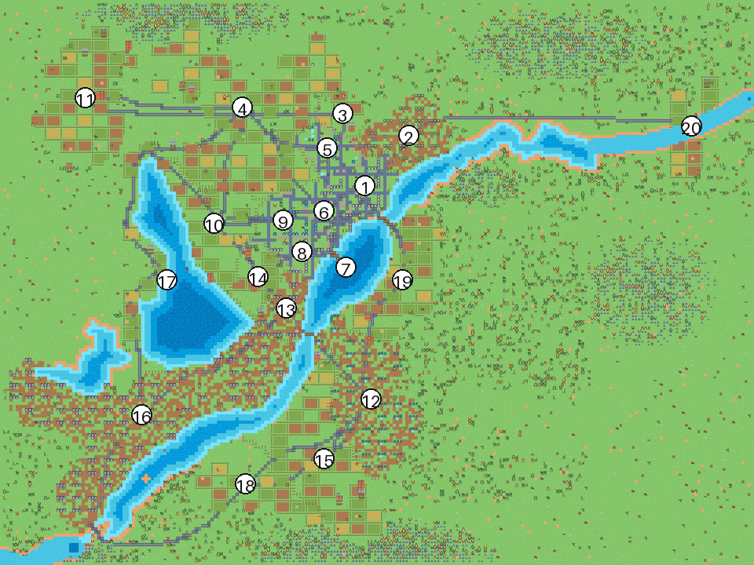
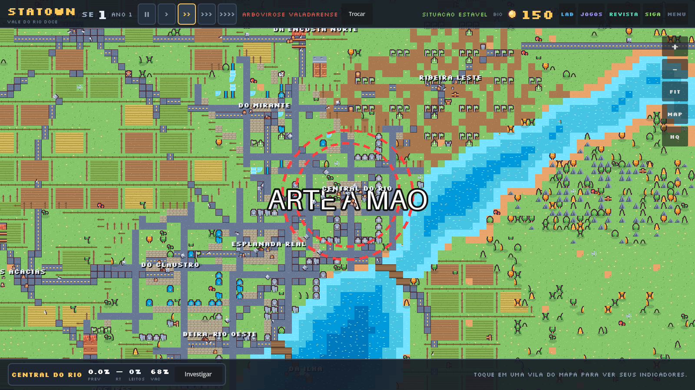

# Editar a arte do mapa — guia manual

Este guia é para quem quer **pintar o mapa com a própria mão**, sem mexer no gerador.
Ele explica o que é cada arquivo, qual caminho usar e o que **não** é arte (para o jogo
não quebrar).

> Regra de ouro: o mapa do jogo é uma **imagem grande fatiada em 16 pedaços**. O que você
> edita é o PNG mestre; o jogo lê os pedaços. O script `tools/split_world.py` faz o corte.

---

## 1. Anatomia do mapa

| Arquivo | Tamanho | O que é | Quem usa |
|---|---|---|---|
| `assets/Gemini_Generated_FULL-MAP.jpeg` | 2400×1792 | **ilustração-fonte** do vale (mapa ilustrado) | `tools/bake_map.py` |
| `tools/terrain_ids.png` | 240×180 | classificação do terreno (8 classes) | `tools/bake_map.py` e `tools/render_world.py --terreno` |
| `assets/art/world_map.png` | 3840×2880 RGB | **mapa completo** (240×180 tiles de 16 px) | ninguém em runtime — é a fonte |
| `assets/art/world/chunk_C_L.png` | 16 × 960×720 | pedaços do mapa (grade 4×4) | `WorldView` desenha só o que aparece na tela |
| `assets/art/world_mini.png` | 960×720 | miniatura | `Assets.mini_mapa` |
| `assets/art/decor.png` | 3840×2880 RGBA | **camada de decoração**, transparente | desenhada **por cima** do mapa (opcional) |
| `assets/art/decor/chunk_C_L.png` | 16 × 960×720 | decoração fatiada (gerada) | idem, versão leve para celular |
| `data/map_data.json` | — | âncoras das vilas, máscaras de água/zona, rotas | **lógica**, não é arte (ver seção 8) |
| `tools/bake_map.py` | — | **gera o mapa atual** a partir da ilustração (bake pixel-art) | pipeline (não é editor) |
| `tools/render_world.py` | — | gerador legado (estilo Kenney); `--terreno` tenta reler a ilustração em tiles | pipeline (não é editor) |

Coordenadas: **1 tile = 16 px**.

### 1.1 Onde fica cada vila no PNG

Para pintar no lugar certo, use a referência abaixo (a miniatura numerada está em
`docs/mapa_vilas.png`). Lembre: **pixel = tile × 16**.



| # | Vila | tile (x, y) | pixel (x, y) |
|---|---|---|---|
| 1 | Vila Central do Rio | 116, 59 | 1856, 944 |
| 2 | Vila Ribeira Leste | 130, 43 | 2080, 688 |
| 3 | Vila da Encosta Norte | 109, 36 | 1744, 576 |
| 4 | Vila das Nascentes | 77, 34 | 1232, 544 |
| 5 | Vila do Mirante | 104, 47 | 1664, 752 |
| 6 | Vila Esplanada Real | 103, 67 | 1648, 1072 |
| 7 | Vila da Ilha | 110, 85 | 1760, 1360 |
| 8 | Vila Beira-Rio Oeste | 96, 80 | 1536, 1280 |
| 9 | Vila do Claustro | 90, 70 | 1440, 1120 |
| 10 | Vila das Acácias | 68, 71 | 1088, 1136 |
| 11 | Vila do Vale Distante | 27, 31 | 432, 496 |
| 12 | Vila da Ponte Sul | 118, 127 | 1888, 2032 |
| 13 | Vila Entre-Pontes | 91, 98 | 1456, 1568 |
| 14 | Vila dos Ipês | 82, 88 | 1312, 1408 |
| 15 | Vila do Pico | 103, 146 | 1648, 2336 |
| 16 | Vila Fabril Sudoeste | 45, 132 | 720, 2112 |
| 17 | Vila Horizonte Oeste | 53, 89 | 848, 1424 |
| 18 | Vila da Várzea Sul | 78, 154 | 1248, 2464 |
| 19 | Vila das Chácaras | 128, 89 | 2048, 1424 |
| 20 | Vila da Cachoeira Leste | 220, 40 | 3520, 640 |

O rótulo com o nome da vila é desenhado pelo jogo em cima da âncora — não precisa pintar
nome no mapa (e pintar atrapalha quando a vila muda de nome no `data/vilas.json`).


---

## 2. Caminho A — trocar a arte pela ilustração (bake)

É assim que o mapa do jogo é feito hoje: a ilustração
`assets/Gemini_Generated_FULL-MAP.jpeg` (2400×1792, o mapa ilustrado do Vale do Rio
Doce) vira o PNG mestre em estilo pixel art. Três comandos, nesta ordem:

```bash
python3 tools/extract_terrain.py          # 1) classifica o terreno (8 classes)
python3 tools/bake_map.py                 # 2) gera mestre + chunkes + map_data.json
python3 tools/split_world.py --verificar  # 3) confere o recorte (0 diferenças)
```

**O que cada etapa faz**

| Etapa | Entrada | Saída | Para que serve |
|---|---|---|---|
| `extract_terrain.py` | JPEG da ilustração | `tools/terrain_ids.png` (240×180), `tools/water_mask_base.png`, `tools/terrain_preview.png` | separa água, mata, serra, lavoura, cidade e asfalto; daqui saem a máscara do rio (rota dos barcos) e o viés das rotas |
| `bake_map.py` | JPEG + `terrain_ids.png` | `world_map.png` 3840×2880, 16 chunkes, `world_mini.png`, `data/map_data.json` | reduz para 1920×1440 (LANCZOS), quantiza em 96 cores, amplia 2× com **NEAREST** (blocos de 2×2 px), extrai as rotas do asfalto da arte, calcula o barco e grava tudo |
| `split_world.py --verificar` | mestre + chunkes | relatório | prova que o jogo está lendo a arte certa |

**Trocar a ilustração por outra** (ex.: uma versão nova do Gemini): salve o novo JPEG
como `assets/Gemini_Generated_FULL-MAP.jpeg` (qualquer tamanho — o script
redimensiona), rode os três comandos e abra o jogo. Se as cores mudarem muito, ajuste
os limiares de `tools/extract_terrain.py` olhando `tools/terrain_preview.png` (é o
classificador desenhado em cores chapadas, sem enfeite).

**Ajustes de estilo** (todos em `tools/bake_map.py`):

| Quero | Mude |
|---|---|
| mais "chapado" ou mais "pintado" | `CORES = 96` (64 = mais pixel; 192 = mais detalhe) |
| blocos maiores (pixel mais grosso) | `MEIO_W, MEIO_H = rw.W // 2, rw.H // 2` → `// 3` |
| ruas do jogo mais visíveis | em `desenhar_rotas()`: `width=5` e a cor `(46, 42, 52, 70)` |

> ⚠️ O bake **sobrescreve** `world_map.png`, os 16 chunkes e `data/map_data.json`.
> A arte Kenney original está guardada em `assets/art_backup/` (com `.gdignore`, fora
> do build) — é o seu "desfazer": copie de volta e rode `split_world.py`.

---

## 3. Caminho B — camada de decoração (recomendado)

Pintar em `decor.png` é o jeito seguro: você **não toca** no mapa gerado, então pode
experimentar à vontade, apagar, refazer — e a arte continua lá mesmo se alguém rodar o
gerador de novo.

Serve para: placas, letreiros, marcos (farol, estátua, ponte desenhada), trilhas,
pegadas, textos no mapa, correções pontuais (um buraco, uma árvore a mais), e qualquer
coisa que você queira desenhar à mão.

**Passo a passo**

1. Abra `assets/art/decor.png` em **Aseprite, Krita, GIMP, Pixelorama** (ou Photoshop).
   Ele já vem no tamanho certo (3840×2880) e **todo transparente** — é o seu papel em
   branco. Se o programa perguntar, **não achate** (mantenha o canal alfa).
2. Pinte **numa camada nova** por cima. Use lápis/pincel duro (sem antialias, sem
   suavização), paleta do jogo (ver seção 7). Trabalhe com zoom alto: cada pixel conta.
3. Salve **como PNG RGBA** em `assets/art/decor.png` (é o mesmo arquivo).
4. **No editor do Godot**: aperte `F5`. O Godot reimporta o PNG sozinho ao salvar e o
   desenho aparece na hora. (Se o jogo já estiver rodando fora do editor, feche e rode de
   novo — ou rode `godot --headless --import` antes.)
5. **Para o build web/celular**: rode o fatiador e exporte:
   ```bash
   python3 tools/split_world.py --decor
   /home/marcio/opt/godot/godot --headless --export-release "Web" exports/web/index.html
   ```

**Por que fatiar?** Enquanto a arte não é fatiada, o jogo carrega o PNG inteiro como uma
textura (3840×2880 RGBA ≈ 42 MB de memória). Fatiado em 16 pedaços, entra o mesmo custo
do mapa (cada pedaço só existe uma vez). No editor, a versão não fatiada é usada de
propósito, para o ciclo "salvar → F5" ser imediato — inclusive se você editar o mestre
depois de já ter fatiado (o `AssetRegistry` compara a data dos arquivos e usa o mais novo).

**Ordem de desenho:** chunkes do mapa → decoração → *overlay* epidemiológico (o mapa de
calor por vila, `z_index 2`) → carros, barcos e pessoas → rótulos. Ou seja, com o mapa de
calor ligado, a sua arte recebe a mesma tingida das vilas — é o comportamento desejado
(a camada é de leitura, não de arte).



*Teste de fumaça da camada: o círculo vermelho e o texto "ARTE A MAO" foram pintados em
`decor.png` e aparecem por cima do mapa, sem alterar nenhum chunk. A arte foi removida
depois; o arquivo que acompanha o projeto está transparente.*

---

## 4. Caminho C — repintar o mapa inteiro

Quando você quer mexer no **terreno e nos quarteirões** (trocar uma rua, refazer uma
praça, apagar uma fábrica), edite o mestre:

1. Faça **backup** — o projeto não está sob git no ambiente local, então a cópia é a sua
   rede de segurança: `cp assets/art/world_map.png assets/art/world_map.backup.png`
   (se você mantém uma cópia versionada em outro lugar, `git commit` antes também serve).
2. Abra `assets/art/world_map.png` (RGB, sem alfa) e pinte.
   Use **NEAREST/vizinho mais próximo** em qualquer redimensionamento. Não use filtro
   suave, não salve em JPEG.
3. Rode o fatiador:
   ```bash
   python3 tools/split_world.py             # regera os 16 chunkes + minimapa
   python3 tools/split_world.py --verificar # confirma que os chunkes batem com o mestre
   ```
4. `F5` no editor. Para web, exporte de novo.

> ⚠️ **Atenção:** rodar `python3 tools/render_world.py` **ou** `python3 tools/bake_map.py`
> **sobrescreve** `world_map.png` e joga fora a sua pintura. Os dois são geradores, não
> editores. Se quiser mudanças
> sistemáticas (outra paleta de grama, menos árvores), o caminho é o C.

---

## 5. Caminho D — mudar o gerador (mudanças sistemáticas)

O mapa nasce de `tools/render_world.py`: cores em `C = {...}`, densidade de árvores,
largura das ruas, perfis de vila (`PROFILES`), blocos urbanos, fazendas, indústria. Editar
ali e rodar

```bash
python3 tools/render_world.py     # ~1-2 min; regera world_map.png, chunkes e map_data.json
```

é o certo para "quero o vale mais verde", "quero menos ruas no centro", "quero as vilas
rurais com mais pasto". O custo é que o resultado é procedural: cada execução muda
detalhes (sementes), então trate o PNG final como descartável.

---

## 6. Caminho E — tilemap no Godot ou Tiled (por que não)

O mapa **não é um tilemap**: ele foi *bakeado* em uma imagem. Cada tile de grama foi
sorteado e desenhado pixel a pixel, então não existe hoje uma grade de índices que um
editor de tiles consiga abrir e salvar de volta. Para usar `TileMapLayer` (o padrão da
Godot 4.3+, como no demo oficial `demos/2d/dynamic_tilemap_layers`) ou o Tiled, seria
preciso reescrever o gerador para emitir camadas de tile e refazer o `WorldView` — um
projeto à parte, que perderia o detalhe procedural atual.

Se um dia isso for desejado, o desenho é: `render_world.py` grava `world_tiles.json`
(240×180 índices por camada) + `tileset.png`; `WorldView` troca os 16 sprites por um
`TileMapLayer`; o `decor.png` continua por cima. Nada disso é necessário para editar a
arte à mão hoje.

---

## 7. Regras de ouro da arte

| Regra | Motivo |
|---|---|
| **16 px = 1 tile** | todo o jogo mede distância em tiles (âncoras, rotas, raio das vilas) |
| **vizinho mais próximo** (NEAREST) | pixel art com filtro suave vira borrão no zoom |
| **sem antialias / sem transparência parcial** no mapa base | o mapa é RGB; alfa vira preto |
| **paleta do jogo** | grama `#84C669` (clara `#AAE393`, escura `#65A556`), água `#75E3FF` (fundo `#007ABE`), areia `#EAA56C` (borda `#C56E33`), pedra `#C0CBDC` (sombra `#52607C`), asfalto `#677794`, terra `#AA784E` |
| **PNG, nunca JPEG** | JPEG cria manchas de cor em pixel art |
| **não mude o tamanho** | 3840×2880 é contrato do `WorldView` e do fatiador |

Cores exatas do gerador estão em `tools/render_world.py` (dicionário `C`). Sprites soltos
para colar na decoração: `assets/extracted/kenney_tiny-town/Tiles/tile_XXXX.png` (casas,
árvores, bancos), `assets/extracted/kenney_tiny-farm/Tiles/` (plantações, cercas),
`assets/extracted/kenney_tiny-city/Tiles/` (prédios), `kenney_tiny-factory/Tiles/`
(galpões). São CC0.

---

## 8. O que **não** é arte (e quebra o jogo se ficar dessincronizado)

`data/map_data.json` guarda a **lógica** que o jogo usa em cima da imagem:

| Campo | Para que serve | Se você mover a arte… |
|---|---|---|
| `zones[].anchor` | centro da vila (clique, câmera, rótulo) | o clique abre a vila errada — atualize o `anchor` |
| `zones[].bbox`, `area_tiles` | tamanho da mancha urbana | usado em mobilidade/estatística; atualize se mudar muito |
| `zone_rle` | máscara 240×180 de qual vila domina cada tile | pessoas usam para se locomover |
| `water_rle` | máscara de água | rota dos barcos e “é água?” |
| `roads` | grafo antigo de ruas (fragmentos) | não é mais a pista principal; ver `traffic_routes.json` |
| `boats` | rota dos barcos | barcos |

As rotas longas de carros e caminhões **não** ficam em `map_data.json`: são geradas
por `tools/build_traffic_routes.py` a partir de `assets/art/road_nav_mask.png` e salvas
em `data/traffic_routes.json`. A máscara original (`road_mask.png`) é a referência
visual; a versão `road_nav_mask.png` é derivada por
`tools/build_road_nav_mask.py` (fechamento de 1 px) e só serve ao A* e ao
`RoadMask`. O eixo do veículo fica dentro da máscara em tempo de execução.

Duas formas de manter isso coerente:

1. **Mexeu só em detalhe visual?** Nada a fazer — âncoras e máscaras continuam válidas.
2. **Mudou a posição de uma vila, um rio ou uma ponte?** Rode
   `python3 tools/render_world.py`, que regera `map_data.json` junto com o mapa (perde a
   pintura manual do mestre, mas a `decor.png` é preservada), **ou** edite à mão o
   `map_data.json` (os RLE são pares `[valor, quantidade]`, decodificados por
   `VilaRegistry._rle_decode`).

O nome/parâmetros das vilas ficam em `data/vilas.json`; `map_data.json` só complementa com
geometria.

---

## 9. Checklist antes de publicar

- [ ] `python3 tools/split_world.py --verificar` → `0 chunkes fora de sincronia`
- [ ] `python3 tools/split_world.py --decor` (se pintou decoração)
- [ ] `godot --headless --import` sem erro
- [ ] `F5`: o mapa abre, as vilas continuam clicáveis no lugar certo
- [ ] `SmokeUI` 37/37 e `Capture` sem `SCRIPT ERROR`
- [ ] exportar web e abrir no navegador (o build não reimporta nada: ele usa o que estava
      no disco na hora da exportação)
