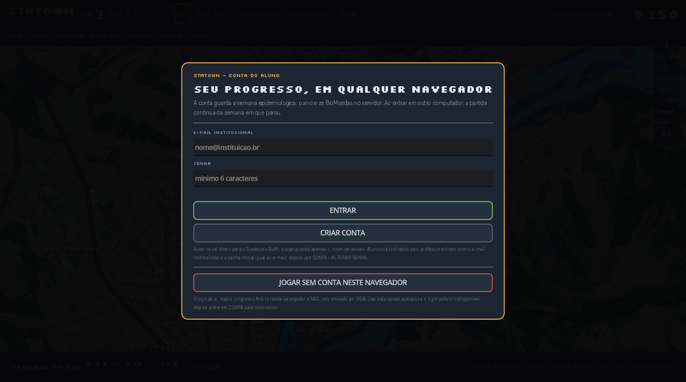
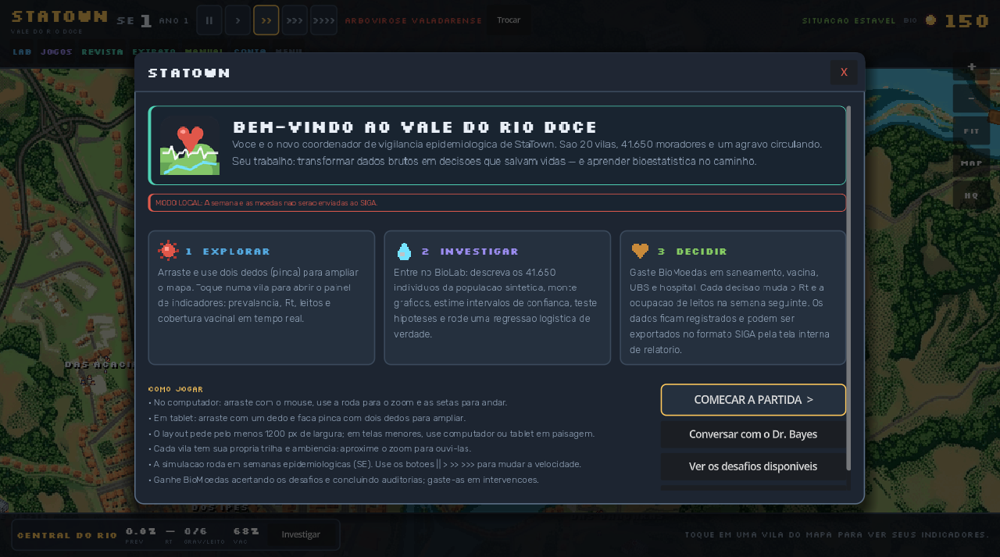
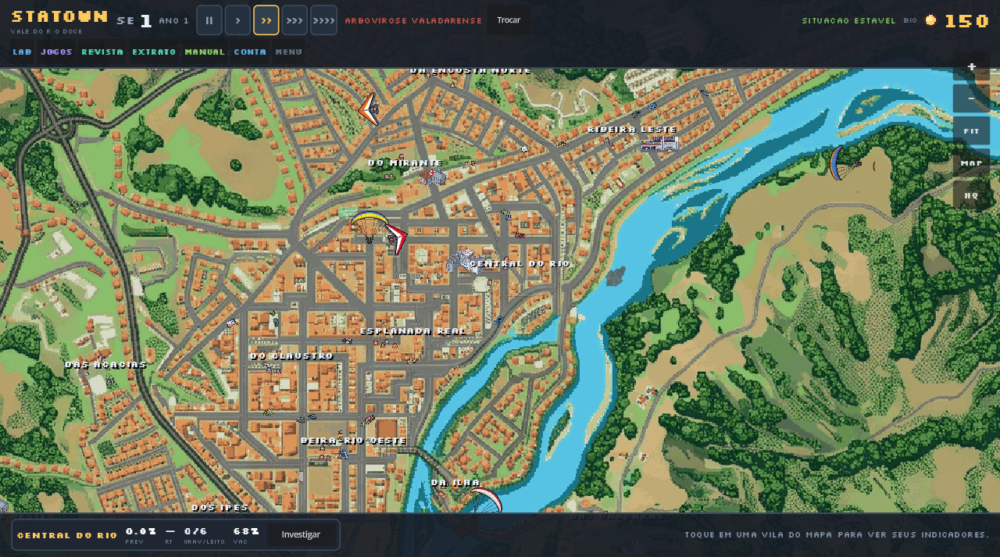

# StaTown — auditoria de usabilidade e integração SIGA

**Data:** 28/11/2026
**Projeto:** StaTown (`statown/`)
**Avaliação usada:** `Game Educativo Statown`
**Período SIGA:** `2026/3`
**Versão do jogo:** Godot 4.7.2, renderizador GL Compatibility, export web local.

> Este relatório é evidência técnica. Nomes, e-mails e matrículas de alunos não são
> reproduzidos; apenas totais, turmas, IDs de avaliação e notas agregadas.

---

## 1. Resposta curta

1. **Não existe teto global de moedas no jogo.** O aluno pode repetir minigames,
   semanas, auditorias do Dr. Bayes e surtos e continuar ganhando saldo.
2. **Conteúdo único de uma primeira passagem soma 1.886 moedas** (sem surtos e sem
   repetir nada): 630 dos 9 minigames + 1.000 dos 50 artigos + 160 do LAB + 96 do
   Dr. Bayes. O saldo inicial de 150 **não** entra nessa conta.
3. **Para a nota, valem no máximo 1.000 moedas ganhas.** O excedente continua no
   extrato e no saldo, mas não aumenta a nota.
4. A regra implementada é **1000 moedas ganhas = nota máxima da avaliação**. Nas
   **três turmas com o alvo**, o peso de `Game Educativo Statown` é **40,0**; a nota
   vai de 0,0 a 40,0, truncada em uma casa decimal:
   `nota = min(40,0; floor(min(moedas_ganhas, 1000) * 40,0 * 10 / 1000) / 10)`.
5. A reconsulta final, somente leitura, encontrou **0 nota no alvo** nas três turmas
   com a avaliação; o relatório intermediário registrava 4 valores sintéticos, mas eles
   **não reapareceram** e não foram recriados. A turma `CBV018GV-B`, que **não** tem a
   avaliação, não recebeu nota e **não teve avaliação criada**.
6. A suíte final passou: **47/47** StatCore, **101/101** SmokeUI, **93/93** Câmera,
   **129/129** Áudio, **50/50** Economia, **15/15** Moedas, **8/8** Conta,
   **22/22** Desafios, **1802/1802** Revista, **17/17** Tráfego e **52 semanas** de
   auditoria sem falhas.
7. Os commits foram enviados para `origin/main`; o workflow **Publicar no Vercel**
   concluiu com sucesso e a branch `deploy` foi atualizada. O build local também está
   em `exports/web/` para revisão.

---

## 2. Regra de moedas → nota

### 2.1 Fonte única

| Camada | Arquivo | O que faz |
|---|---|---|
| Jogo | `scripts/autoload/EconomyManager.gd` | `nota_participacao()` lê `data/economia.json` e usa `moedas_ganhas_total` |
| Dados | `data/economia.json` | `moedas_para_nota_maxima: 1000`, `nota_maxima: 40`, `base: "moedas_ganhas"` |
| Lançador SIGA | `scripts/lancar_nota_siga.py` | repete a mesma aritmética antes do `POST /api/lancar-notas` |
| Supabase | `docs/SUPABASE_NOTA.sql` | coluna gerada `nota numeric(4,1)` com a mesma fórmula |
| Testes | `tests/TestEconomia.gd`, `tests/TestMoedas.gd` | provam os limites e a nota |

### 2.2 Aritmética inteira (sem artefato de ponto flutuante)

O jogo e o lançador calculam em **décimos inteiros**:

```text
limite_decimos = round(peso * 10)                  # 40,0 -> 400
nota_decimos   = min(limite_decimos,
                     floor(moedas * limite_decimos / 1000))
nota           = nota_decimos / 10
```

Isso evita o erro binário que fazia **285 moedas aparecerem como 11,3**; agora
aparecem **11,4**. A truncagem é intencional: 999 moedas valem 39,9 e só 1000 valem
40,0.

### 2.3 Exemplos verificados

| Moedas ganhas | Conta (décimos) | Nota | Observação |
|---:|---:|---:|---|
| 0 | 0 | 0,0 | sem participação |
| 285 | floor(285 × 400 / 1000) = 114 | **11,4** | caso do bug antigo (11,3) |
| 333 | 133 | **13,3** | exemplo do plano de teste de `CBV018GV-A` |
| 500 | 200 | **20,0** | exemplo do plano de teste de `CBV044GV-A` |
| 740 | 296 | **29,6** | exemplo intermediário |
| 999 | 399 | **39,9** | não arredonda para 40,0 |
| 1.000 | 400 | **40,0** | teto da nota |
| 1.390 | 400 (limitado) | **40,0** | 390 moedas de excedente |
| 1.886 | 400 (limitado) | **40,0** | uma passagem única |

---

## 3. Quanto um aluno pode ganhar?

### 3.1 Conteúdo único (uma passagem)

| Fonte | Conta | Moedas |
|---|---|---:|
| 9 minigames, acerto total | 9 × (10 + round(60 × 1,0)) = 9 × 70 | **630** |
| 50 artigos da Revista | 50 × 20 | **1.000** |
| 6 contextos do LAB, melhor desafio de cada | 25 + 25 + 25 + 25 + 30 + 30 | **160** |
| Dr. Bayes, 8 temas, 12 por primeiro acerto | 8 × 12 | **96** |
| **Total único** | 630 + 1.000 + 160 + 96 | **1.886** |

O teste `TestMoedas` comprova exatamente esses valores e imprime:

```text
MOEDAS: conteudo unico=1886, teto da nota=1000, saldo apos repeticoes=3436
MOEDAS: 15 verificacoes, 0 falhas
```

O valor **3.436** é o saldo após o teste somar 20 repetições de um minigame:
1.886 + 1.400 = 3.286 moedas ganhas, mais as 150 iniciais. A nota continua 40,0 e o
excedente aparece no extrato.

### 3.2 Repetição e surtos

- Minigames podem ser repetidos; cada repetição paga de 10 a 70.
- Semanas podem avançar; o LAB paga até 160 por semana (um desafio por contexto).
- Auditorias do Dr. Bayes podem ser refeitas em novas instâncias do painel.
- Um surto controlado paga até 60 por vila e pode ocorrer mais de uma vez.

**Conclusão:** não há um “máximo absoluto” de moedas ganhas. O máximo *sem repetir
conteúdo* é **1.886**; o máximo que **conta para a nota** é **1.000**. Se a pergunta
for “quanto precisarei para garantir 40,0?”, a resposta é **1.000 moedas ganhas**.

---

## 4. Estado do alvo no SIGA

### 4.1 Reconsulta final (28/11/2026, 17:59, somente leitura)

| Turma | Alunos | Avaliações | Alvo | Peso | Notas do alvo | Valores |
|---|---:|---:|---|---:|---:|---|
| `CBV018GV-A` | 7 | 4 | `602508` | 40,0 | **0** | — |
| `CBV044GV-A` | 31 | 4 | `602512` | 40,0 | **0** | — |
| `EST006GV-A` | 2 | 4 | `602511` | 40,0 | **0** | — |
| `CBV018GV-B` | 20 | 3 | — | — | **0** | **sem alvo; nada criado** |

Total: **0 nota** no alvo. O `GET /api/notas?turma=...&periodo=2026/3` devolveu
HTTP 200, exatamente uma avaliação `Game Educativo Statown` por turma (peso 40,0) e
nenhum valor preenchido nela. A turma `CBV018GV-B` continua com três avaliações e
**sem** o alvo. Nenhum `POST /api/lancar-notas` foi feito nesta rodada; o botão do
aluno foi levado até a confirmação, mas o segundo clique não foi disparado.

### 4.2 Histórico do relatório intermediário

A versão anterior deste relatório registrava quatro valores sintéticos lançados por
`POST /api/lancar-notas`:

| Turma | Moedas de teste | Nota esperada | Valor registrado então |
|---|---:|---:|---:|
| `CBV018GV-A` | 333 | 13,3 | 13,3 |
| `CBV044GV-A` | 500 | 20,0 | 20,0 |
| `CBV044GV-A` | 999 | 39,9 | 39,9 |
| `EST006GV-A` | 1.000 | 40,0 | 40,0 |

Esses valores **não estão presentes na reconsulta final**. Os quatro backups locais
gravados pelo lançador têm 231 bytes e `notas_antes` vazio, portanto não servem como
prova do estado anterior. A API do SIGA não oferece endpoint público de auditoria de
alterações; não é possível determinar, por essa via, se os valores foram removidos,
se nunca chegaram a ser gravados ou se outra pessoa os apagou. Por segurança, este
relatório passa a tratar **0 nota** como o estado atual e **não recria** nenhum valor
sem autorização explícita do professor.

### 4.3 Outras avaliações

As avaliações existentes nas turmas continuam com seus nomes, pesos e quantidades;
o script só escreve na descrição exata do alvo. Não houve criação, renomeação,
exclusão ou alteração de peso em:

- `CBV018GV-A`: `Exercício Avaliativo` (10), `Prova 1` (20), `Trabalho sobre Probabilidades` (30).
- `CBV044GV-A`: `Exercício Avaliativo` (10), `Prova 1` (20), `Trabalho sobre Probabilidades` (30).
- `EST006GV-A`: `Exercícios` (10), `Prova` (20), `Trabalho sobre Probabilidades` (30).
- `CBV018GV-B`: `Introdução ao método estatístico` (100), `Técnicas de Amostragem nas Ciências da Saúde` (100), `Análise Exploratória de Dados` (100).

### 4.4 Backups locais das tentativas

Guardados em `~/.dsh/dados/siga_backups/` (modo 600), mas com `notas_antes` vazio
(231 bytes); não comprovam as quatro notas do relatório intermediário:

- `siga_backup_CBV018GV-A_20261128_103409.json`
- `siga_backup_CBV018GV-A_20261128_103436.json`
- `siga_backup_CBV044GV-A_20261128_103446.json`
- `siga_backup_EST006GV-A_20261128_103455.json`

---

## 5. Correções de usabilidade e consistência

| Área | Problema encontrado | Correção / evidência |
|---|---|---|
| Nota | 285 moedas exibiam 11,3 por erro de ponto flutuante | Cálculo em décimos inteiros; teste 285 → 11,4 |
| Nota | Fórmula duplicada no jogo, no Python e no SQL | Mesma regra documentada e testada nas três camadas |
| Login | Toast de “modo local” (e de erro de sincronização) cobria botões | Aviso virou faixa compacta; erro de sync fica só no status do painel, sem toast sobre os botões |
| Login | Falha de rede podia deixar o aluno preso na tela inicial | Botão **JOGAR SEM CONTA NESTE NAVEGADOR**, com texto explícito de que nada sobe ao SIGA |
| Boas-vindas | Quatro caminhos de entrada podiam ficar abaixo da dobra em 1280 px | Faixa compacta; **COMECAR A PARTIDA** permanece visível e o painel tem rolagem |
| LAB — tabela | Nomes de vila clipados na coluna | Prefixo “Vila ” removido **só na tabela**; o CSV mantém o nome completo |
| LAB — filtros | `OptionButton` descritivo abria vazio | `select(0)` explícito, largura mínima e altura 34 |
| LAB — gráficos | IDs internos apareciam como rótulos | Rótulos legíveis (`rotulo`) em títulos e eixos |
| LAB — ROC | Preenchimento escondia grade e curva | Preenchimento desenhado antes dos eixos, alfa 0,10 |
| LAB — testes | Aba vazia sem contexto | Título “GRAFICO DO TESTE” + dica de estado vazio |
| Tabelas | Colunas largas estouravam o modal | Rolagem horizontal e larguras proporcionais |
| Revista | Títulos longos e resumos apertados | Ajuste de quebra/rolagem sem cortar metadados |
| Economia | Extrato/CSV sem largura adequada | Rolagem e cabeçalho fixos; CSV com nomes completos |
| Captura | Primeiras duas imagens saíam em 1600×932 | Capture usa `--resolution 1600x900`; 24/24 em 1600×900 |
| Responsividade | 1200 px com fonte pequena; 2000 px sem recorte | Auditoria em 1200/1600/2000; documentado 1600 como confortável |
| Mobile | 390 px em retrato é ilegível | Fora do escopo; o jogo pede desktop/tablet em paisagem e ≥1200 px |

As capturas de documentação em `docs/shots/` foram refeitas depois dos ajustes:
**24 PNGs, todos 1600×900**, sem `SCRIPT ERROR`.

---

## 6. Testes executados

### 6.1 Suíte Godot

| Teste | Resultado |
|---|---|
| `--headless --import` | exit 0 |
| `test_statcore.gd` | **47/47** |
| `SmokeUI` | **101 passos, 0 falhas** |
| `TestCamera` | **93 passos, 0 falhas** |
| `TestAudio` | **129 passos, 0 falhas** |
| `TestAudit` | **52 semanas, 0 falhas, 0 avisos** |
| `TestTrafego` | **17 passos, 0 falhas** |
| `TestEconomia` | **50 verificações, 0 falhas** |
| `TestMoedas` | **15 verificações, 0 falhas** |
| `TestConta` | **8 verificações, 0 falhas** |
| `TestDesafios` | **22 verificações, 0 falhas** |
| `TestRevista` | **1802 verificações, 0 falhas** |
| `Capture` | **24 PNGs, 0 SCRIPT ERROR**, 1600×900 |

Comandos usados (a partir de `statown/`):

```bash
GODOT=/home/marcio/opt/godot/godot
$GODOT --headless --import
$GODOT --headless --script tests/test_statcore.gd
$GODOT --headless res://tests/SmokeUI.tscn
$GODOT --headless res://tests/TestCamera.tscn
$GODOT --headless res://tests/TestAudio.tscn
$GODOT --headless res://tests/TestAudit.tscn
$GODOT --headless res://tests/TestTrafego.tscn
$GODOT --headless res://tests/TestEconomia.tscn
$GODOT --headless res://tests/TestMoedas.tscn
$GODOT --headless res://tests/TestDesafios.tscn
$GODOT --headless res://tests/TestRevista.tscn
DISPLAY=:0 $GODOT --path . res://tests/Capture.tscn --resolution 1600x900
```

### 6.2 Manual e export

| Verificação | Resultado |
|---|---|
| `docs/manual.html` — capítulos `<h2>` | 24 (Sumário + 23 capítulos) |
| Figuras (``) | 19 |
| Links internos | 176, **0 quebrados** |
| Imagens ausentes | **0** |
| `img src=""` | **0** |
| `index.html` | 5,4 KB |
| `index.js` | 274 KB |
| `index.pck` | 12.377.864 bytes (~12 MB) |
| `index.wasm` | 39.514.754 bytes (~38 MB) |
| Capturas copiadas para `exports/web/shots/` | 24 |
| Manual copiado para `exports/web/manual.html` | sim |

### 6.3 Navegador

Teste local com Chrome headless 158.0.8127.88, WebGL 2.0 via SwiftShader:

- Canvas em **1280×713** e **1600×813** (área útil do navegador, sem barra de
  ferramentas).
- Login abriu, o botão **JOGAR SEM CONTA NESTE NAVEGADOR** funcionou e o jogo
  carregou o mapa.
- O aviso de modo local aparece **dentro** do painel de boas-vindas; **não há toast
  sobre os botões**.
- O botão **COMECAR A PARTIDA** fechou o modal e abriu o mapa.







Observação: em 1280 px, a faixa de aviso é legível, mas as ações secundárias
(`CONFIGURACOES DO JOGO`) podem exigir rolagem; a ação primária fica visível. Em
1600×900 nativo a leitura é confortável; no navegador, a área útil menor (barras do
navegador) também pode exigir rolagem. Isso é compatível com o contrato de 1200–2000 px,
que já documenta 1600 px como largura recomendada.

---

## 7. Riscos e limites

1. **Publicação:** o push do commit `41d9910` acionou o workflow **Publicar no
   Vercel** (`46172949371`), que concluiu com sucesso, rodou a etapa Deno e atualizou
   a branch `deploy`. A produção respondeu em `https://statown.vercel.app` e foi
   testada com a conta sintética.
2. **Áudio do navegador**: `TestAudio` cobre buses e volumes, mas não foi medida a
   saída RMS no navegador nesta rodada. O ajuste
   `general/default_playback_type.web=0` continua no `project.godot`; uma verificação
   com `AnalyserNode` ainda é recomendada antes de publicar.
3. **Mobile em retrato** não é suportado. Em 390 px o layout é ilegível; use desktop,
   notebook ou tablet em paisagem.
4. **1200 px** é o mínimo técnico, mas a fonte fica pequena; 1600 px (ou “Fonte
   grande” em 1280) é o uso confortável.
5. **SIGA**: a reconsulta final é somente leitura e encontrou **0 nota no alvo**,
   embora o relatório intermediário registrasse 4. Não há endpoint público de
   auditoria de “quem alterou o quê”; os backups locais estão vazios. A garantia de que
   as outras avaliações não foram tocadas vem do escopo do script (só
   `/api/lancar-notas` com a descrição exata do alvo), da conferência de nomes,
   pesos e quantidades.
6. **Dados de alunos** não são reproduzidos neste relatório. Os CSVs de turma
   permanecem em `~/.dsh/dados/2026-3/` com permissão 600; os backups do SIGA também.

---

## 8. Arquivos principais alterados

- `scripts/autoload/EconomyManager.gd` — nota em décimos inteiros.
- `data/economia.json` — regra 1000 → nota máxima.
- `scripts/lancar_nota_siga.py` — lançamento seguro, dry-run, backup, máscara.
- `docs/SUPABASE_NOTA.sql` — coluna gerada e view.
- `tests/TestEconomia.gd`, `tests/TestMoedas.gd` — provas da regra.
- `tests/TestConta.gd` — regressão da requisição de progresso perdida no login e
  ordem save → Edge Function no envio da nota.
- `supabase/functions/enviar-nota-siga/index.ts` — Edge Function autenticada que
  recalcula e envia somente a matrícula do próprio aluno.
- `supabase/functions/enviar-nota-siga/nota_test.ts` — testes puros da nota e do
  semestre.
- `scripts/ui/panels/PanelLogin.gd` — nota projetada, botão **ENVIAR AO SIGA** e
  confirmação em dois cliques.
- `scripts/world/WorldView.gd`, `tests/TestTrafego.gd` — fatores de tamanho,
  altitude, sombra e neblina dos planadores.
- `scripts/ui/panels/PanelBoasVindas.gd`, `scripts/game/Main.gd` — aviso compacto
  pós-login, sem toast sobre os botões.
- `scripts/ui/panels/PanelBioLab.gd`, `scripts/ui/StatChartCanvas.gd` — ajustes de
  tabela, filtros, rótulos e ROC.
- `tests/Capture.gd` — captura em 1600×900 sem `window_set_size`.
- `README.md`, `AGENTS.md`, `docs/manual.html` — regra, máximo e limites.

---

## 9. Checklist final

- [x] Regra 1000 moedas → nota máxima implementada e testada.
- [x] Máximo de conteúdo único calculado (1.886) e teto de crédito (1.000) separados.
- [x] Nenhuma avaliação nova criada; turma sem o alvo não recebeu nota.
- [x] Reconsulta final somente leitura: 0 nota no alvo; valores antigos não recriados.
- [x] Suíte Godot completa sem falhas.
- [x] 24 capturas em 1600×900 e manual com 0 links/imagens quebrados.
- [x] Build web local abre, login local funciona e o mapa carrega.
- [x] Commit `41d9910` e push para `origin/main`; workflow `46172949371` e produção
      Vercel com sucesso (28/11/2026).
- [ ] Repor/validar notas de teste no SIGA (exige autorização e escrita real).
- [x] Login com Supabase validado no Chromium; painel fecha após baixar o progresso.
- [ ] Medição de RMS de áudio no navegador (recomendada antes de publicar).

---

## 10. Correção pós-publicação: login parado em "Carregando..."

O aluno autenticava, via "Login realizado. Carregando o progresso...", mas o jogo
não abria. A causa não era a senha nem o Supabase Auth: `ContaManager._ao_http()`
limpava `_atual` depois de processar a resposta. O sinal de login dispara
`baixar_progresso()` de forma síncrona; essa chamada já iniciava a requisição
seguinte, e a limpeza posterior apagava a tag dela. A resposta do progresso chegava
sem tag, não era tratada e a tela ficava presa.

A correção guarda a requisição concluída em uma variável local e limpa `_atual`
**antes** dos callbacks. Assim, a requisição de progresso disparada pelo login (e o
upload disparado por uma conta nova) continuam com sua tag. `TestConta` cobre o
encadeamento `carregar -> salvar` com 8 verificações.

Validação no Chromium, com build web e o mesmo Supabase de produção:

| Cenário | Resultado |
|---|---|
| Conta sintética nova | login concluiu, conta foi criada no servidor e o save inicial subiu |
| Segundo acesso, progresso já existente | login concluiu e carregou a semana 7 gravada no servidor |
| Conta e dados sintéticos | removidos ao final; nenhum dado de aluno real foi usado |

O login manual também foi conferido com o botão **ENTRAR** (não apenas com a tecla
Enter). O teste de regressão roda no workflow de publicação.

---

## 11. Rodada 2: envio individual ao SIGA e altitude visual

### 11.1 O que mudou

**Envio pelo aluno.** O painel **CONTA**, quando há sessão ativa, passou a mostrar a
**nota projetada** e o botão **ENVIAR AO SIGA**. O primeiro clique transforma o botão
em **CONFIRMAR ENVIO** e explica o efeito; o segundo chama
`Conta.enviar_nota_siga()`. O cliente espera o save pendente terminar de subir e só
depois chama a Edge Function `enviar-nota-siga`, com o JWT do aluno e apenas o
semestre interno. A função:

- confirma o JWT em `/auth/v1/user`;
- lê apenas o perfil e o progresso do próprio aluno (RLS);
- exige matrícula, turma e período SIGA no perfil e o semestre interno atual;
- exige **exatamente uma** avaliação `Game Educativo Statown` já existente na turma;
- recalcula a nota com o peso real da avaliação;
- grava somente a matrícula do próprio aluno e confere por um segundo GET;
- não devolve nome, e-mail, lista da turma ou corpo bruto do SIGA.

A `SIGA_API_KEY` ficou no segredo da função; nenhuma chave administrativa entrou no
build. A função **não tem chamada de criação de avaliação**: se o alvo não existir,
retorna erro e nada é escrito. O script do professor continua disponível para
conferência e lançamento em lote.

**Altitude visual.** As duas asas-deltas recebem fatores `0,86` e `1,14`; os quatro
parapentes recebem `0,78`, `0,90`, `1,02` e `1,14`, embaralhados a cada montagem. O
fator vira escala, deslocamento vertical, sombra mais distante/fraca e uma neblina
azulada discreta. O objetivo é dar leitura de profundidade sem tirar a legibilidade
do mapa. `TestTrafego` confere tamanhos distintos, amplitude dos parapentes, sombra
mais distante para o planador mais alto e a nova composição.

### 11.2 Evidências técnicas

| Verificação | Resultado |
|---|---|
| `TestConta` | **8/8** — fila, login, semestre e ordem save → função |
| `TestTrafego` | **17/17** — veículos, tamanhos, altitudes, sombras e recarga |
| `SmokeUI` | **101/101** — inclui painel CONTA ativo e primeiro clique de confirmação |
| `TestEconomia` | **50/50** — regra de nota e semestre |
| `nota_test.ts` (Deno) | **3/3** — 1000 → peso, pesos alternativos e virada de semestre |
| Edge Function | publicada, `verify_jwt=true`; `OPTIONS` 204, sem JWT 401, bearer inválido 401 |
| Conta sintética sem perfil SIGA | 422 antes de qualquer escrita |
| Conta sintética com turma fictícia `TESTE-A` | 502 (SIGA recusou a turma), sem POST de nota |
| Auto-cadastro com matrícula/turma/período forjados no metadata | perfil nasceu com os três campos vazios; conta removida |
| SIGA `GET /api/notas` | 200, exatamente uma `Game Educativo Statown`, peso 40,0; **0 nota no alvo** na reconsulta |
| Build web local | painel CONTA abriu, mostrou `Projetada: 0,0 / 40,0` e confirmou no primeiro clique |
| GitHub Actions `46172949371` | sucesso; etapa Deno `3/3` e todos os testes Godot passaram |
| Perfis no Supabase | 61 linhas; **60** com matrícula + turma + período; 1 incompleta (sem PII) |
| Produção `https://statown.vercel.app` | login sintético, CONTA e confirmação em dois cliques; console sem erro |

Capturas (conta sintética, sem dado real):
[planadores com tamanhos/altitudes](web_planadores_altitude_1600.png) ·
[CONTA com o botão](web_conta_siga_1600.png) ·
[confirmação em dois cliques](web_conta_siga_confirmar_1600.png) ·
[produção: confirmação](web_producao_conta_1280.png).

A conta sintética usada nas capturas (`...@example.invalid`) foi removida do
Supabase Auth ao fim do ensaio; nenhum aluno real foi usado.

**O que não foi feito:** o segundo clique não foi disparado com uma matrícula real
nesta rodada, para não gravar nota sintética. A escrita do botão deve ser validada em
uma turma/avaliação de teste; a função já foi testada até os caminhos de erro antes
do SIGA. Nenhuma avaliação foi criada ou alterada nas outras avaliações.

### 11.3 Limites

1. O save continua vindo do navegador; a função recalcula a nota, mas não prova que
   a jogada aconteceu. A mitigação continua sendo conferência do extrato, atividade
   presencial e/ou simulação autoritativa no servidor.
2. O botão depende de o professor ter preenchido matrícula, turma e período no
   perfil; sem isso, ele fica desabilitado e a tela explica o motivo.
3. O servidor recusa semestre diferente do calendário atual no fuso
   `America/Sao_Paulo`, para não enviar save de um semestre antigo.
